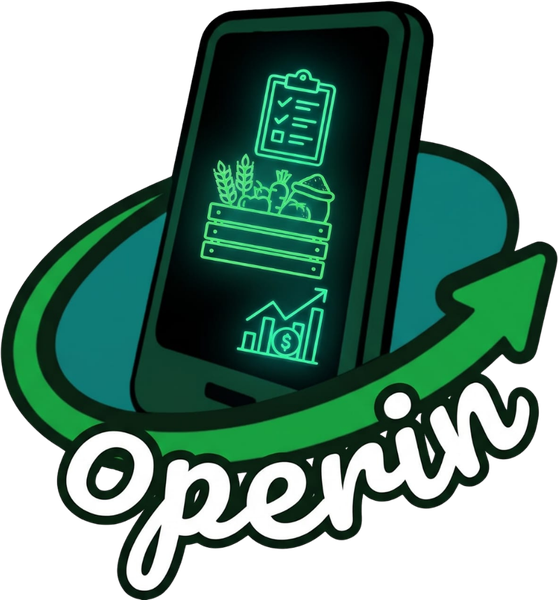

<p align="center">
  
</p>

<h1 align="center">Operin</h1>

<p align="center">
  <b>Ekosistem penyelamatan stok & barter surplus bahan baku untuk UMKM kuliner</b><br>
  Subtema: <i>AI for Business & Digital Innovation</i> (Pemberdayaan UMKM)
</p>

<p align="center">
  
  
  
  
</p>

---

Operin membantu UMKM kuliner mencegah kerugian dari bahan baku yang mendekati
kedaluwarsa. Caranya lewat **penyelamatan dua lapis**:

1. **Lapis 1:** stok yang mendekati batas aman otomatis diberi saran diskon atau
   flash sale.
2. **Lapis 2:** surplus dijodohkan dengan UMKM tetangga terdekat lewat pasar B2B,
   barter, atau penyaluran ke mitra daur ulang.

Kualitas bahan dinilai dari **foto oleh AI multimodal**, dan setiap transaksi yang
berhasil tercatat sebagai **dampak nyata** (rupiah terselamatkan, limbah dicegah,
UMKM terbantu).

## Masalah yang dipecahkan

Banyak toko roti, kedai kopi, warung jus, dan katering rugi diam-diam karena salah
memprediksi stok. Bahan baku menumpuk, mendekati kedaluwarsa, lalu terbuang.
Padahal dalam radius beberapa ratus meter sering ada UMKM lain yang justru sedang
membutuhkan bahan itu. Operin mempertemukan keduanya sebelum bahan terbuang.

## Fitur utama

### 1. Scan Stok & AI Quality Grading
Pemilik usaha cukup memotret bahan baku (kamera atau galeri). AI vision (Groq,
model `qwen/qwen3.8-27b`) lalu mengembalikan, untuk tiap bahan di foto:

- **Identitas bahan:** nama, kategori, dan perkiraan jumlah beserta satuannya.
- **Grade kualitas:** A, B, C, atau Tidak Layak, plus **skor kesegaran 0–100%**.
- **Tanggal kedaluwarsa:** dibaca langsung dari label kemasan, atau diperkirakan
  dari sisa masa simpan bila tidak ada label.
- **Alasan penilaian dan rekomendasi olahan**, misalnya "olah hari ini" atau
  "cocok untuk adonan bolu".

Hasil scan bisa langsung dicatat sebagai stok dengan satu ketukan. Formnya terisi
otomatis, sehingga pengguna tinggal melengkapi harga.

### 2. Penyelamatan Lapis 1: Smart Stock Rescue
- Setiap stok diberi status otomatis: **Aman / Segera / Kritis / Kedaluwarsa**.
  Ambang kritisnya mengikuti preferensi notifikasi H-1, H-2, atau H-3.
- **Saran aksi dan diskon** dihitung dari sisa hari dan jenis bahan. Bahan mudah
  busuk mendapat diskon lebih besar. Saran ini disertai nilai stok yang berisiko
  dan perkiraan pemasukan yang bisa diselamatkan.
- Promo **Diskon** atau **Flash Sale** terbit dengan satu ketukan, dengan harga yang
  dibulatkan otomatis.
- Stok yang sudah kedaluwarsa diarahkan ke **mitra daur ulang** (kompos atau pakan).

### 3. Penyelamatan Lapis 2: Pasar B2B & Matchmaking antar-UMKM
- **Pasar B2B** punya tiga bagian:
  - **Flash Sale** dan **Sale** untuk promo surplus.
  - **Katalog** untuk stok UMKM lain dengan harga normal.

  Pasar dilengkapi pencarian, jarak dalam km, dan filter radius. Alurnya:
  ajukan → penjual terima atau tolak → tandai selesai.
- **Matchmaking B2B** memberi skor kecocokan tiap UMKM berdasarkan:
  - kategori bahan yang saling dibutuhkan,
  - urgensi kedaluwarsa,
  - jarak.

  Setiap skor disertai alasan, misalnya *"Saling membutuhkan, cocok untuk barter"*.
- **Barter dengan negosiasi:** tawaran balik dengan aturan giliran, plus chat
  di setiap penawaran.
- **Penyaluran donasi** stok kedaluwarsa ke mitra daur ulang.
- **Realtime:** pesanan, barter, dan chat dari perangkat lain langsung muncul
  tanpa perlu muat ulang.

### 4. Dasbor Dampak Terukur
Kartu statistik di halaman utama otomatis bertambah setiap kali transaksi selesai:

| Metrik | Cara hitung |
|---|---|
| **Kerugian terselamatkan (Rp)** | Penjualan + penghematan pembeli dari diskon + nilai stok yang dibarter |
| **Limbah makanan dicegah (kg)** | Berat stok yang berpindah tangan (perkiraan per satuan) |
| **UMKM tetangga terbantu** | Jumlah mitra berbeda yang pernah bertransaksi |
| **Emisi dicegah (kg CO₂e)** | Limbah × 2,5 (faktor perkiraan) |

Halaman **Dampak & Riwayat** menampilkan grafik 6 bulan, perbandingan dengan bulan
lalu, dan riwayat aktivitas per tanggal.

### Fitur pendukung
- **Akun dan sesi:** daftar dan login email dengan *Remember me*, lalu pilih peran:
  **Penjual Surplus**, **Pembeli Bahan Baku**, atau **Mitra Daur Ulang**.
- **Profil usaha:** nama usaha dan WhatsApp, kategori bahan yang diminati, radius
  jangkauan, serta **lokasi pada peta** (OpenStreetMap + GPS).
- **Manajemen stok:** tambah, ubah, hapus, filter status, dan pencarian.

## Cara kerja

```
 Foto bahan ──► Scan AI (Edge Function → Groq Vision) ──► Stok + grade + kedaluwarsa
                                                              │
                         ┌──────────── H-3 … H-1 ─────────────┤
                         ▼                                    ▼
             Lapis 1: saran diskon / flash sale    Lapis 2: Pasar B2B, Katalog,
                         │                          Matchmaking, Barter, Donasi
                         └───────────────┬────────────────────┘
                                         ▼
                     Transaksi selesai → stok berpindah otomatis
                                         ▼
                    Dasbor Dampak: Rp terselamatkan, kg limbah, UMKM terbantu
```

## Teknologi

| Lapisan | Teknologi |
|---|---|
| Aplikasi | Flutter 3.47 (Material 3), Android & Web |
| Backend | Supabase: PostgreSQL, Auth, Realtime, Edge Functions |
| Keamanan data | Row Level Security, dan transaksi lewat fungsi RPC atomik |
| AI | Groq Vision LLM via Edge Function `scan-food` (key AI hanya di server) |
| Peta & lokasi | flutter_map + OpenStreetMap, geolocator |
| Kamera | image_picker + permission_handler |

## Menjalankan proyek

**Prasyarat:**
- Flutter SDK 3.47 atau lebih baru.
- Akun Supabase.
- Android Studio, untuk build Android.

1. **Siapkan backend.** Ikuti [`supabase/README.md`](supabase/README.md). Isinya:
   - buat project Supabase,
   - jalankan migrasi SQL,
   - deploy Edge Function `scan-food`,
   - isi secret `GROQ_API_KEY`.
2. **Sambungkan aplikasi.** Isi Project URL dan Publishable key di
   [`lib/core/config/supabase_config.dart`](lib/core/config/supabase_config.dart),
   atau berikan saat build:
   ```bash
   flutter run --dart-define=SUPABASE_URL=https://<ref>.supabase.co --dart-define=SUPABASE_KEY=sb_publishable_...
   ```
3. **Jalankan aplikasinya:**
   ```bash
   flutter pub get
   flutter run                 # perangkat Android / emulator
   flutter run -d chrome       # web
   ```
4. **Buat APK:**
   ```bash
   flutter build apk --release
   # hasil: build/app/outputs/flutter-apk/app-release.apk
   ```

## Struktur proyek

```
lib/
├── core/          # tema, routing, sesi, konfigurasi, utilitas (format, jarak, waktu)
├── data/          # repository Supabase, layanan AI scan, realtime
├── model/         # model data (stok, promo, pesanan, barter, aktivitas, hasil scan)
├── features/      # auth, onboarding, dashboard, stock, rescue, market,
│                  # matchmaking, scanner, impact, location
└── widgets/       # komponen UI bersama
supabase/
├── migrations/    # skema, RLS, view, dan fungsi transaksi (SQL)
└── functions/     # Edge Function scan-food (Deno)
test/              # unit & widget test
```

## Pengujian

```bash
flutter analyze
flutter test
```

Cakupan test:
- **Logika bisnis:** status kedaluwarsa, rekomendasi rescue, skor matchmaking,
  dan perhitungan dampak.
- **Pemetaan data Supabase** ke model aplikasi.
- **Pembacaan jawaban AI.**
- **Alur UI utama** (widget test): login, onboarding, stok, promo, pasar dan
  katalog, barter, transaksi, dan scan AI.

## Rencana pengembangan

Bagian konsep berikut belum ada di versi ini:

- **Paket bundling menu** dan **teks promosi WhatsApp** yang dibuat AI untuk
  pelanggan toko sendiri (Lapis 1).
- **Harga B2B yang adil** dan **potensi kerugian rupiah** yang dihitung langsung
  oleh AI dari hasil scan. Saat ini saran diskon masih memakai aturan berdasarkan
  sisa hari.
- **Draf pesan penawaran buatan AI** di Matchmaking. Saat ini pencocokan memakai
  skor berbasis aturan, dan pesan pembukanya masih templat.
- **Notifikasi push** saat stok mendekati kedaluwarsa.
- **Ekspor laporan dampak.**

## Catatan

- **Sifat angka dampak:** angka dampak (berat per satuan dan faktor CO₂e) adalah
  perkiraan untuk ilustrasi.
- **Penilaian AI:** penilaian AI bersifat bantuan. Pengguna tetap disarankan
  memeriksa bahan secara langsung.
- **Kunci di aplikasi:** URL dan publishable key Supabase memang aman berada di
  aplikasi, karena akses data dibatasi oleh Row Level Security. Key AI disimpan
  sebagai secret di server.
